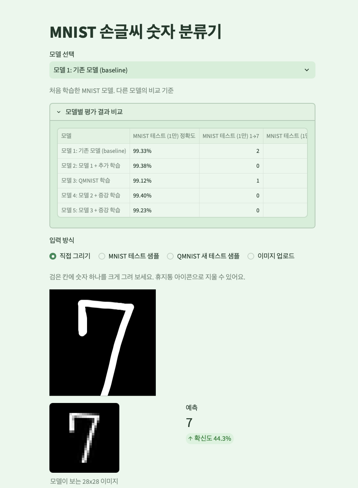
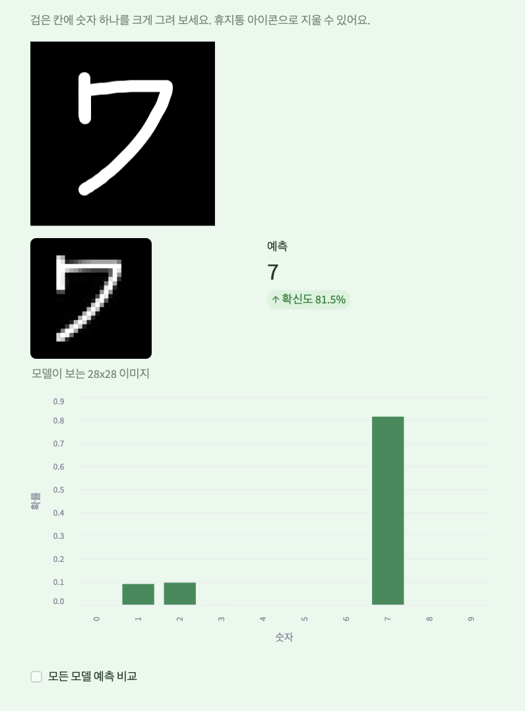

# MNIST 손글씨 숫자 분류기: 모델 1~5 비교

같은 CNN 구조로 **학습 방법만 바꾼 모델 다섯 개**를 만들고, 같은 기준으로 평가해 Streamlit 앱에서 골라 쓸 수 있게 했습니다. 직접 그린 숫자에서 **7을 1로 헷갈리는 문제**를 줄이는 것이 목표였습니다.

## 요약

| 항목 | 내용 |
|---|---|
| 문제 | 28×28 손글씨 숫자 이미지 → 0~9 분류, 특히 1과 7의 혼동 줄이기 |
| 모델 | 같은 CNN(`SimpleClassifier`, 파라미터 421,642개)으로 학습 방법만 다른 5개 |
| 평가 | MNIST 테스트 1만 장 + **QMNIST 새 테스트 5만 장**(학습·튜닝에 한 번도 쓰지 않은 데이터) |
| 화면 | Streamlit 앱: 모델 선택, 직접 그리기 / 샘플 / 업로드, 모든 모델 예측 비교 |
| 결과 | QMNIST 5만 장 기준 **7→1 혼동 8건 → 3건** (증강 학습), 정확도는 99% 수준 유지 |
| 핵심 | 학습을 더 하는 것만으로는 7→1이 줄지 않았고, **증강을 넣었을 때 줄었습니다** |

## 모델 설계도

다섯 모델 모두 같은 구조입니다. 앞부분(CNN)이 이미지에서 모양 특징을 뽑고, 뒷부분(MLP)이 그 특징으로 숫자를 판단합니다.

```
입력 1×28×28 (흑백)
   │
   ├─ Conv2d(1→32, 3×3, padding=1) ─ ReLU ─ MaxPool(2)     → 32×14×14   작은 무늬(선, 모서리) 찾기
   ├─ Conv2d(32→64, 3×3, padding=1) ─ ReLU ─ MaxPool(2)    → 64×7×7     더 큰 모양(곡선, 꺾임) 찾기
   │
   ├─ Flatten                                              → 3,136
   ├─ Linear(3136→128) ─ ReLU ─ Dropout(0.5)               → 128        특징 종합
   └─ Linear(128→10)                                       → 10         숫자 0~9 점수 → softmax 확률
```

| 층 | 출력 모양 | 파라미터 수 |
|---|---|---|
| Conv2d(1, 32, 3×3) | 32 × 28 × 28 | 320 |
| MaxPool2d(2) | 32 × 14 × 14 | 0 |
| Conv2d(32, 64, 3×3) | 64 × 14 × 14 | 18,496 |
| MaxPool2d(2) | 64 × 7 × 7 | 0 |
| Linear(3136, 128) | 128 | 401,536 |
| Linear(128, 10) | 10 | 1,290 |
| **합계** | | **421,642** |

## 모델 1~5 비교

구조, 전처리, 옵티마이저(Adam), 손실(교차 엔트로피), 평가셋은 모두 같고 **학습 방법만** 다릅니다.

| 항목 | 모델 1 | 모델 2 | 모델 3 | 모델 4 | 모델 5 |
|---|---|---|---|---|---|
| 이름 | 기존 모델 (baseline) | 모델 1 + 추가 학습 | QMNIST 학습 | 모델 2 + 증강 | 모델 3 + 증강 |
| 시작 가중치 | 무작위 | 모델 1 | 무작위 | 모델 2 | 모델 3 |
| 학습 데이터 | MNIST 6만 | MNIST 6만 | QMNIST 6만 | MNIST 6만 | QMNIST 6만 |
| 에폭 | 3 | +5 (누적 8) | 5 | +5 (누적 13) | +5 (누적 10) |
| 학습률 | 1e-3 | 1e-4 | 1e-3 | 1e-4 | 1e-4 |
| 배치 크기 | 64 | 128 | 128 | 128 | 128 |
| 데이터 증강 | 없음 | 없음 | 없음 | **있음** | **있음** |
| 학습 코드 | D46 노트북 | `train_models.py` | `train_models.py` | `train_aug.py` | `train_aug.py` |
| 확인하려는 것 | 비교 기준 | 더 오래 배우면? | 데이터를 바꾸면? | 증강을 더하면? (MNIST) | 증강을 더하면? (QMNIST) |

**증강 내용**: 학습할 때마다 이미지를 회전 ±10°, 이동 ±10%, 크기 0.9~1.1배, 기울임 ±10° 범위에서 무작위로 바꿔 보여 줍니다. 평가와 앱에서는 원래 이미지를 그대로 씁니다.

## 주요 결정과 근거

### 1. 모델 구조는 고정하고 학습 방법만 바꿨습니다
결과 차이를 학습 방법 때문이라고 말하려면 나머지가 같아야 합니다. 그래서 모델 구조, 전처리(평균 0.1307, 표준편차 0.3081), 평가 함수를 `mnist_common.py` 하나로 모아 학습 스크립트와 앱이 같은 코드를 쓰게 했습니다.

### 2. 증강을 넣었습니다
학습을 더 오래 하는 것(모델 2)은 같은 글씨를 반복해서 볼 뿐이라 **새로운 모양**을 배우지 못합니다. 직접 그린 숫자는 기울기, 위치, 크기가 MNIST와 다르기 때문에, 학습 중 이미지를 조금씩 변형해 보여 주는 증강을 넣었습니다. 증강은 데이터 수를 늘리지 않고, 같은 6만 장을 **에폭마다 다른 모양**으로 보여 줍니다.

### 3. 평가는 QMNIST 새 5만 장을 기준으로 봤습니다
- **테스트가 많을수록 점수를 믿을 수 있습니다.** MNIST 1만 장은 정확도 차이 0.1%p를 우연과 구분하기 어렵지만, 5만 장은 흔들림 폭이 절반 이하로 줄어듭니다.
- **7→1 같은 드문 실수를 셀 수 있습니다.** 1만 장에서는 몇 건 차이라 비교가 어렵습니다.
- **아무도 튜닝에 쓰지 않은 시험지입니다.** MNIST 테스트 1만 장은 오랫동안 많이 쓰여 그 시험지에 맞춰졌을 수 있습니다.

### 4. 모델 4는 모델 2에서 이어서, 모델 5는 모델 3에서 이어서 학습했습니다
"모델 2 → 4"와 "모델 3 → 5"를 같은 조건(증강 + 5에폭)으로 맞춰, 두 데이터셋에서 증강 효과를 나란히 비교했습니다.

## 학습 결과

| 모델 | MNIST 1만 정확도 | 1→7 | 7→1 | **QMNIST 5만 정확도** | **1→7** | **7→1** |
|---|---|---|---|---|---|---|
| 모델 1: 기존 모델 (baseline) | 99.33% | 2 | 2 | 98.98% | 5 | **8** |
| 모델 2: 모델 1 + 추가 학습 | 99.38% | 0 | 2 | **99.14%** | 3 | **8** |
| 모델 3: QMNIST 학습 | 99.12% | 1 | 2 | 98.92% | 7 | 4 |
| 모델 4: 모델 2 + 증강 학습 | **99.40%** | 0 | 2 | 99.13% | 4 | **3** |
| 모델 5: 모델 3 + 증강 학습 | 99.23% | 0 | 3 | 99.12% | **2** | **3** |

### 결과에서 알 수 있는 점
- **추가 학습은 정확도만 올렸습니다.** 모델 2는 QMNIST 정확도가 0.16%p 올랐지만, 7→1은 8건 그대로였습니다.
- **증강이 7→1을 줄였습니다.** 모델 2 → 4에서 정확도는 거의 같은데(99.14% → 99.13%) **7→1이 8건 → 3건**으로 줄었습니다. 모델 3 → 5에서도 정확도가 0.20%p 오르고, 1→7은 7건 → 2건, 7→1은 4건 → 3건으로 줄었습니다.
- **1↔7 혼동 합계**(QMNIST 기준): 모델 1 13건 → 모델 4 7건, 모델 5 5건
- **QMNIST로 학습해도 정확도는 오르지 않았습니다.** 모델 3은 두 평가셋 모두 모델 1보다 낮았습니다. QMNIST 학습셋은 MNIST 학습셋을 같은 방식으로 다시 만든 것이라 데이터 자체의 차이가 거의 없습니다.

## 실행 방법

```bash
# 1. 패키지 설치
pip install -r requirements.txt

# 2. 모델 1~3 평가·학습 (models/mnist_state_dict.pth 가 있어야 합니다)
python train_models.py

# 3. 모델 4·5 증강 학습
python train_aug.py

# 4. 앱 실행
streamlit run mnist_ui.py
```

- 데이터셋(MNIST, QMNIST)은 처음 실행할 때 `data/`에 자동으로 내려받습니다.
- `models/` 폴더에 학습된 가중치와 결과 json이 있으면 2~3단계 없이 바로 앱을 실행할 수 있습니다.
- 앱은 `models/*.json`을 읽어 모델 목록을 만들고, 화면은 `.streamlit/config.toml`의 연한 초록 테마로 열립니다.

## 폴더 구조

```
mnist_classifier/
├ README.md
├ requirements.txt
├ .gitignore                  ← data/ 제외
├ .streamlit/config.toml      ← 테마 설정
├ mnist_common.py             ← 공통: 모델 구조, 전처리, 평가 함수
├ train_models.py             ← 모델 1·2·3
├ train_aug.py                ← 모델 4·5
├ mnist_ui.py                 ← Streamlit 앱
├ models/                     ← 가중치(.pth)와 평가 결과(.json)
├ notebooks/Mnist_QMNIST.ipynb
└ screenshots/
```

## 한계와 다음 단계

- **가로줄 그은 7은 아직 확인하지 못했습니다.** MNIST·QMNIST는 미국 손글씨라 가로줄 7이 거의 없습니다. 위 결과는 테스트셋 기준이며, 직접 그린 7에 대한 개선은 **정답이 붙은 직접 그린 평가셋**(가로줄 7, 일반 7, 막대 1 각 20장)을 만들어 따로 측정해야 합니다.
- **모델 1과 3은 학습 조건이 완전히 같지 않습니다.** 모델 1은 3에폭·배치 64, 모델 3은 5에폭·배치 128이라 데이터 차이만의 효과로 보기 어렵습니다.
- **모델 4·5는 증강과 추가 5에폭이 함께 들어갔습니다.** 정확도가 비슷한데 7→1만 줄어든 점으로 증강 효과를 추정했지만, 완전히 분리하려면 같은 에폭으로 증강 없이 학습한 비교군이 필요합니다.
- **모든 결과는 시드 42로 한 번씩 학습한 값입니다.** 7→1 건수처럼 작은 숫자는 실행마다 몇 건씩 달라질 수 있습니다.

## 화면
| 모델 선택과 평가 비교 | 직접 그리기와 모든 모델 예측 비교 |
|---|---|
|  |  |